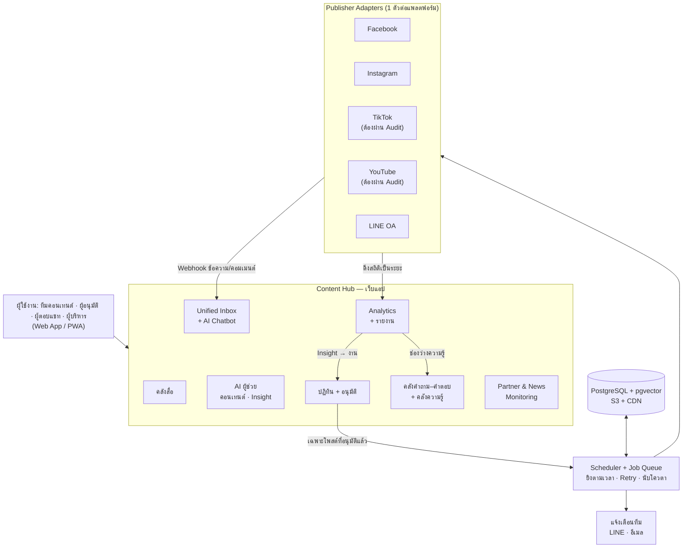
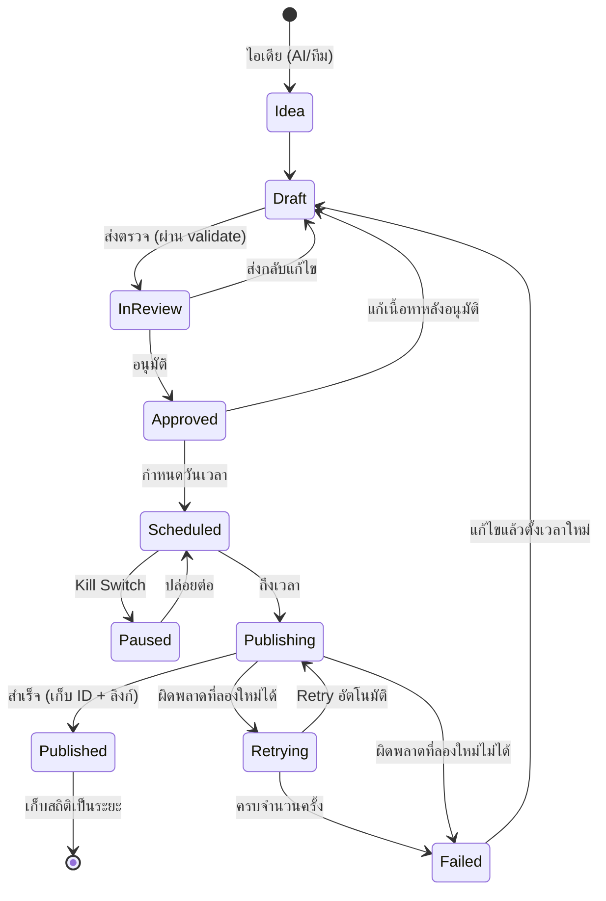
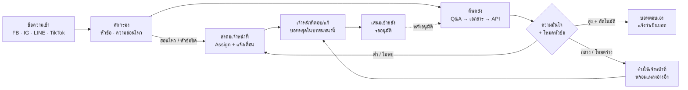
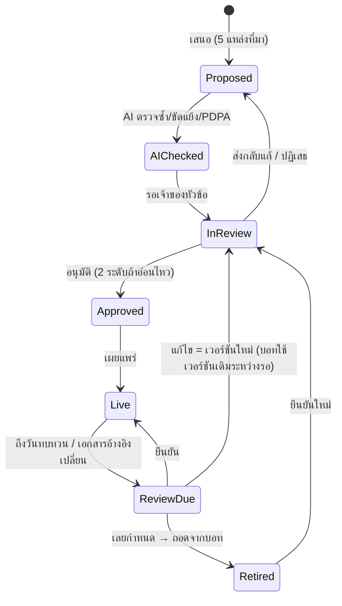
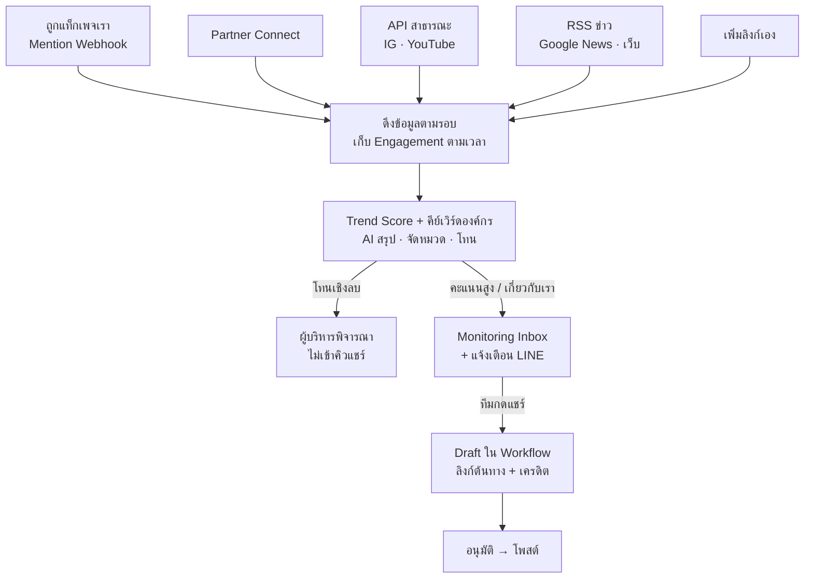
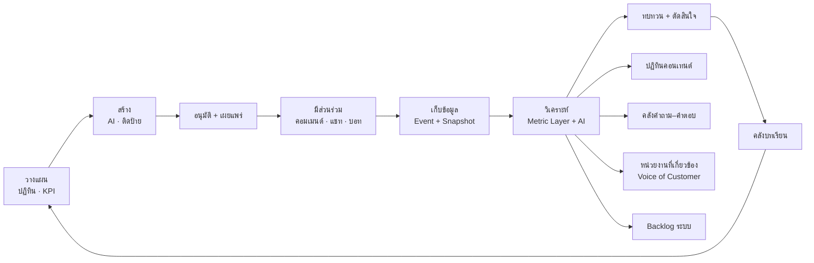
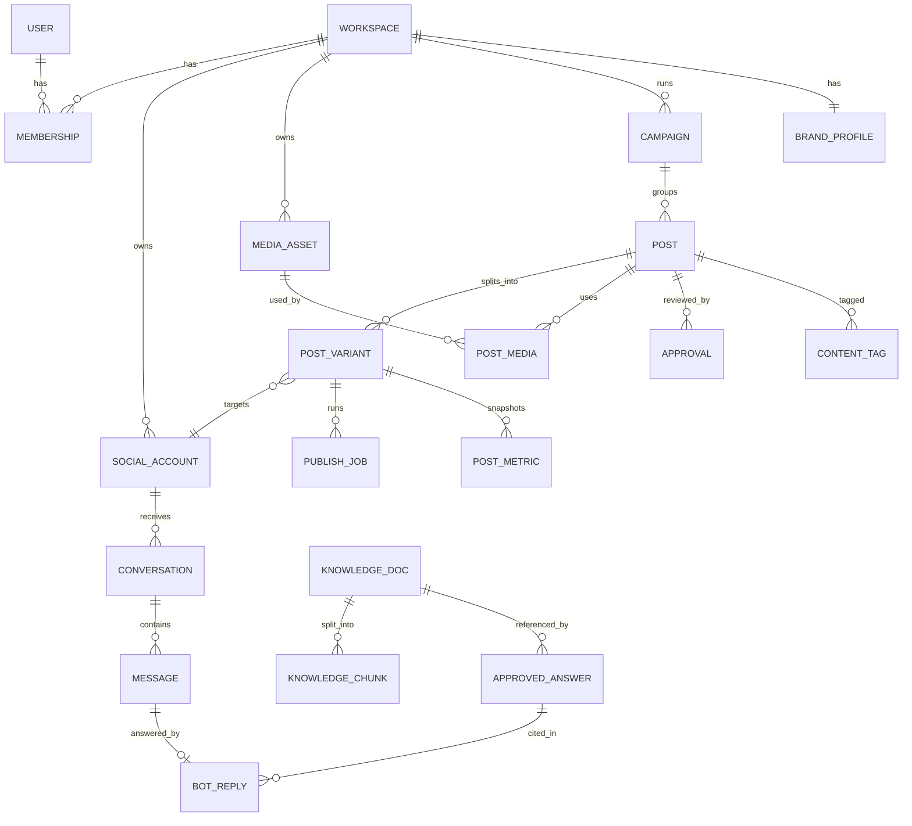

# PRD — ระบบ Social Content Management (SCM)

| รายการ | รายละเอียด |
| --- | --- |
| เวอร์ชันเอกสาร | 1.0 |
| วันที่ | 23 ตุลาคม 2569 (2026-10-23) |
| เจ้าของเอกสาร | นายสุรชัย ศรีอาราม |
| สถานะ | Draft — รอสรุป "ประเด็นที่ต้องตัดสินใจ" (หัวข้อ 17) ก่อนเริ่มเฟส 1 |
| ที่มา | สรุปจากเอกสาร "ระบบ Social Content Management — วิเคราะห์และออกแบบระบบ" |

---

## 0. วิธีอ่านเอกสารนี้

- **รหัส Requirement:** `<โมดูล>-<เลข>` เช่น `PUB-03` ใช้อ้างอิงใน Issue, Commit และ Test Case
- **ลำดับความสำคัญ (MoSCoW):** `M` = Must, `S` = Should, `C` = Could
- **เฟส:** `P0`–`P5` ตามแผนพัฒนาในหัวข้อ 15
- **AC (Acceptance Criteria):** เกณฑ์ที่ต้องผ่านก่อนถือว่า Requirement นั้นเสร็จ
- ตัวเลขขีดจำกัดของ API ทุกแพลตฟอร์มในเอกสารนี้ **ต้องตรวจกับเอกสารทางการอีกครั้งก่อนเริ่มพัฒนาแต่ละเฟส** เพราะเปลี่ยนบ่อย
- ค่าที่ระบุว่า "ค่าเริ่มต้น" หรือ "ค่าที่เสนอ" ให้ทำเป็นค่าที่ตั้งค่าได้ (Configurable) ไม่ฝังในโค้ด

---

## 1. สรุปผู้บริหาร

ระบบ SCM คือศูนย์กลางการบริหารคอนเทนต์และการสื่อสารออนไลน์ขององค์กร ครอบคลุม 5 ช่องทาง ได้แก่ Facebook, Instagram, TikTok, YouTube และ LINE OA ทำได้ตั้งแต่เตรียมคอนเทนต์ ให้ AI ช่วยคิด วางปฏิทิน อนุมัติ ตั้งเวลาโพสต์ ตอบลูกค้าร่วมกันหลายคน ตอบอัตโนมัติด้วย AI Chatbot จากคลังความรู้ที่ผ่านการอนุมัติ ติดตามเพจพันธมิตรและข่าวสาร ไปจนถึงวัดผลและนำผลวิเคราะห์กลับมาปรับแผนแบบวงจรปิด

ข้อเท็จจริงสำคัญที่กำหนดดีไซน์:

- **Facebook และ Instagram** โพสต์อัตโนมัติผ่าน API ได้เต็มที่ (หลังผ่าน App Review)
- **TikTok และ YouTube** ต้องผ่าน Audit ก่อน มิฉะนั้นคลิปที่โพสต์ผ่าน API จะเป็น Private เท่านั้น จึงต้องยื่นตั้งแต่เฟส 0
- **LINE OA** ไม่ใช่การโพสต์บนฟีด แต่เป็นการส่งข้อความหาผู้ติดตาม (Broadcast/Narrowcast) ซึ่งใช้โควตาข้อความตามแพ็กเกจ
- การ **อ่านข้อมูลเพจของคนอื่น** ผ่าน API ทางการทำได้จำกัดมาก ทางที่เสถียรคือให้พันธมิตรเชื่อมบัญชีแบบอ่านอย่างเดียว
- AI ทุกส่วน (คอนเทนต์ บอท Insight) **ต้องมีคนอนุมัติ** ก่อนเผยแพร่ในนามองค์กร ยกเว้นบอทในหัวข้อที่พิสูจน์ความแม่นยำแล้ว

---

## 2. ปัญหา เป้าหมาย และสิ่งที่อยู่นอกขอบเขต

### 2.1 ปัญหาที่ต้องแก้

1. คอนเทนต์และสื่อกระจัดกระจาย โพสต์แต่ละช่องทางต้องเข้าแอปทีละแอป
2. ไม่มีปฏิทินกลาง วางแผนล่วงหน้าและเห็นภาพรวมได้ยาก
3. ไม่มีขั้นตอนอนุมัติที่ตรวจสอบได้ เสี่ยงโพสต์ผิดในนามองค์กร
4. ตอบลูกค้าหลายคนแล้วซ้ำ ตกหล่น หรือโทนไม่เหมือนกัน
5. คำตอบที่ดีไม่ถูกเก็บเป็นความรู้ขององค์กร ต้องตอบเรื่องเดิมซ้ำ
6. ไม่รู้ว่าพันธมิตรหรือข่าวพูดถึงองค์กรว่าอะไร
7. มีตัวเลขแต่ไม่ได้นำไปปรับแผนอย่างเป็นระบบ

### 2.2 เป้าหมายของระบบ

| รหัส | เป้าหมาย | ตัวชี้วัดตัวอย่าง (ค่าเป้ากำหนดในเฟส 0) |
| --- | --- | --- |
| G1 | ลดเวลาเตรียมและเผยแพร่คอนเทนต์ | เวลาเฉลี่ยตั้งแต่ร่างถึงโพสต์, % โพสต์ตามแผน |
| G2 | คอนเทนต์ทุกชิ้นผ่านการอนุมัติและตรวจย้อนได้ | % โพสต์ที่มีบันทึกผู้อนุมัติ = 100% |
| G3 | ตอบลูกค้าเร็วและสม่ำเสมอ | เวลาตอบเฉลี่ย, % ผ่าน SLA, ความพึงพอใจ |
| G4 | สร้างคลังความรู้ขององค์กรที่ใช้ซ้ำได้ | จำนวนคำตอบที่อนุมัติ, อัตราบอทตอบจบเอง |
| G5 | รับรู้ประเด็นเกี่ยวกับองค์กรได้ทันเวลา | เวลาจากโพสต์/ข่าวต้นทางถึงการแจ้งเตือน |
| G6 | ใช้ข้อมูลปรับแผนอย่างต่อเนื่อง | จำนวน Insight ที่ถูกแปลงเป็นงาน/เดือน |

### 2.3 นอกขอบเขต (Non-goals)

- โพสต์ลงโปรไฟล์ Facebook ส่วนตัว หรือกลุ่ม Facebook (API ไม่รองรับ)
- Scraping หรือดึงข้อมูลแพลตฟอร์มด้วยวิธีที่ไม่ใช่ API ทางการ
- ระบบขายของ/ตะกร้าสินค้า และระบบบริหารโฆษณาเต็มรูปแบบ (มีเพียง Boost Post ในระดับ Could)
- การโพสต์ลง LINE VOOM ผ่าน API (เท่าที่ทราบไม่มี Public API)

---

## 3. ผู้ใช้ บทบาท และสิทธิ์

### 3.1 บทบาท

| บทบาท | หน้าที่หลัก |
| --- | --- |
| เจ้าของ (Owner) | ดูแล Workspace, เชื่อมบัญชีโซเชียล, กำหนดนโยบาย (อย่างน้อย 2 คนต่อ Workspace) |
| แอดมิน (Admin) | จัดการผู้ใช้ สิทธิ์ และการตั้งค่า |
| ผู้อนุมัติ (Approver) | อนุมัติคอนเทนต์ คำตอบในคลังความรู้ และตอบเรื่องอ่อนไหว |
| ผู้สร้างคอนเทนต์ (Editor) | สร้าง/แก้ Draft, ใช้ AI ช่วย, วางปฏิทิน |
| ผู้ตอบแชท (Agent) | ตอบแชทและคอมเมนต์ใน Unified Inbox |
| ผู้ดูรายงาน (Viewer) | ดู Dashboard และรายงาน |
| เจ้าของหัวข้อความรู้ (Topic Owner) | สิทธิ์เสริม: ดูแลและอนุมัติคำตอบในหัวข้อที่รับผิดชอบ |
| ผู้ดูแลระบบ (System Admin) | ดูแลโครงสร้างพื้นฐาน, Monitoring ระบบ, ต้นทุน |

### 3.2 ตารางสิทธิ์ (RBAC)

สิทธิ์กำหนดได้ทั้งระดับ Workspace และรายเพจ/รายช่องทาง (เช่น ผู้ตอบแชทบางคนเห็นเฉพาะ LINE)

| สิทธิ์ | Owner | Admin | Approver | Editor | Agent | Viewer |
| --- | --- | --- | --- | --- | --- | --- |
| เชื่อม/ถอดบัญชีโซเชียล | ✓ | ✓ | – | – | – | – |
| จัดการผู้ใช้และสิทธิ์ | ✓ | ✓ | – | – | – | – |
| สร้าง/แก้ Draft | ✓ | ✓ | ✓ | ✓ | – | – |
| อนุมัติและตั้งเวลาโพสต์ | ✓ | ✓ | ✓ | – | – | – |
| ตอบแชทและคอมเมนต์ | ✓ | ✓ | ✓ | – | ✓ | – |
| ตอบเรื่องอ่อนไหว (ร้องเรียน การเงิน สุขภาพ) | ✓ | ✓ | ✓ | – | ร่างได้ ต้องให้หัวหน้าอนุมัติ | – |
| แก้คลังความรู้และคลังคำตอบ | ✓ | ✓ | ✓ | – | เสนอแก้ได้ | – |
| ดูรายงาน | ✓ | ✓ | ✓ | ✓ | เฉพาะงานของตัวเอง | ✓ |
| ดู Audit Log | ✓ | ✓ | – | – | – | – |
| กดหยุดโพสต์ทั้งหมด (Kill Switch) | ✓ | ✓ | ✓ | – | – | – |

---

## 4. ภาพรวมระบบ



หลักการสถาปัตยกรรม:

1. ทุกโพสต์ผ่าน **Scheduler กลางของระบบเราเอง** ไม่พึ่งการตั้งเวลาในตัวของแต่ละแพลตฟอร์ม
2. แต่ละแพลตฟอร์มเป็น **Adapter** ที่ใช้ Interface เดียวกัน เพิ่มแพลตฟอร์มหรือสลับไปใช้บริการตัวกลางได้โดยไม่แตะส่วนอื่น
3. คอนเทนต์ 1 ชิ้น (Post) แตกเป็น **Variant ต่อแพลตฟอร์ม** และแต่ละ Variant มีสถานะและงานโพสต์ของตัวเอง ช่องทางหนึ่งล้มเหลวได้โดยไม่กระทบช่องทางอื่น
4. ทุกการกระทำบันทึกเป็น **Event** เพื่อใช้ทั้ง Audit และ Analytics

---

## 5. ข้อจำกัดของแพลตฟอร์ม (กำหนดดีไซน์)

### 5.1 การโพสต์

| แพลตฟอร์ม | บัญชีที่ต้องใช้ | โพสต์ผ่าน API ได้ | ตั้งเวลา | ขีดจำกัดสำคัญ | การอนุมัติจากแพลตฟอร์ม |
| --- | --- | --- | --- | --- | --- |
| Facebook | Facebook Page เท่านั้น | ข้อความ, ลิงก์, รูป, วิดีโอ, Reels | ในตัว: 10 นาที–30 วันล่วงหน้า | รูปกับวิดีโอผสมในโพสต์เดียวไม่ได้; Reels ราว 30 ชิ้น/เพจ/24 ชม. | App Review: `pages_manage_posts` |
| Instagram | Professional (Business/Creator) | รูป, วิดีโอ (ออกเป็น Reels), Carousel, Stories (เฉพาะ Business) | ไม่มีในตัว | 50–100 โพสต์/24 ชม. (เอกสาร Meta ระบุไม่ตรงกัน ให้เช็ก `content_publishing_limit`); Container หมดอายุใน 24 ชม. | App Review: `instagram_content_publish` |
| TikTok | บัญชีที่ล็อกอินอนุญาต | วิดีโอ, โพสต์รูปภาพ (Direct Post หรือส่งเข้า Draft) | ไม่มีในตัว | ก่อนผ่าน Audit: Private เท่านั้น และไม่เกิน 5 ผู้ใช้/24 ชม.; Access Token อายุ 24 ชม.; ราว 6 คำขอ/นาที/โทเคน | Content Posting API Audit (ต้องมีวิดีโอเดโม UX) |
| YouTube | ช่อง YouTube (OAuth) | วิดีโอ, Shorts | ในตัว: อัปโหลด Private + `publishAt` | โปรเจกต์ที่ยังไม่ Audit คลิปถูกบังคับเป็น Private; โควตาเริ่มต้น 10,000 หน่วย/วัน/โปรเจกต์ | YouTube API Compliance Audit + Google OAuth Verification |
| LINE OA | Official Account + Messaging API Channel | Broadcast, Narrowcast, Push, Multicast (ข้อความ รูป วิดีโอ Flex Message) | ไม่มีใน API | ทุกข้อความนับโควตาต่อผู้รับ 1 คนตามแพ็กเกจ (Reply Message ไม่นับ) | ไม่ต้อง Audit |

ผลต่อดีไซน์:

- ไฟล์สื่อต้องอยู่บน Storage ที่ออก **Signed URL** ได้ เพราะ IG/TikTok/YouTube ดึงไฟล์จาก URL
- ต้องมีงาน **ต่ออายุโทเคนอัตโนมัติ** และแจ้งเตือนเมื่อบัญชีหลุดการเชื่อมต่อ
- LINE ต้องแสดง **จำนวนผู้รับและโควตาที่จะใช้** ก่อนกดส่ง
- ทางลัดระหว่างรอ Audit: ใช้บริการตัวกลางที่ผ่าน Audit แล้ว (เช่น Ayrshare) เป็น Adapter ชั่วคราว; Postiz (โอเพนซอร์ส) ใช้ศึกษาโครงสร้างได้แต่ยังต้องใช้ App ของเราเองและผ่าน Audit

### 5.2 การตอบข้อความอัตโนมัติ

| ช่องทาง | ตอบอัตโนมัติ | เงื่อนไขสำคัญ |
| --- | --- | --- |
| Messenger | ได้ | ภายใน 24 ชม. จากข้อความล่าสุดของลูกค้า; แท็ก `HUMAN_AGENT` ขยายเป็น 7 วันแต่สำหรับเจ้าหน้าที่ตอบเท่านั้น |
| Instagram DM | ได้ | สิทธิ์ `instagram_manage_messages`, กติกาหน้าต่าง 24 ชม. แบบเดียวกัน |
| คอมเมนต์ FB/IG | ได้ | ตอบใต้คอมเมนต์ หรือ Private Reply ทาง DM ได้ 1 ครั้งต่อคอมเมนต์ |
| LINE OA | ได้ | Reply Message ไม่นับโควตา แต่ Reply Token ใช้ได้ครั้งเดียวและหมดอายุเร็ว; ตอบภายหลังต้องใช้ Push ซึ่งนับโควตา |
| TikTok DM | บางส่วน | Business Messaging API ยังเป็นเบต้าผ่านพาร์ตเนอร์; หน้าต่าง 48 ชม., ส่งติดกันไม่เกิน 10 ข้อความ, เริ่มบทสนทนาเองไม่ได้ |
| คอมเมนต์ YouTube | ได้ | ผ่าน Data API ซึ่งใช้โควตา; แนะนำโหมดผู้ช่วยร่างเพราะเป็นข้อความสาธารณะ |

### 5.3 การอ่านข้อมูลเพจภายนอก

| แหล่ง | วิธีอ่านอย่างเป็นทางการ | ได้ข้อมูล | เงื่อนไข |
| --- | --- | --- | --- |
| FB/IG ที่แท็กเพจเรา | Webhook Mention + API ดึงโพสต์ที่ถูกแท็ก | โพสต์ที่ @ หรือแท็กเรา | ใช้ได้ทันทีกับบัญชีเราเอง |
| Facebook เพจพันธมิตร | Partner Connect (แอดมินพันธมิตรอนุญาตสิทธิ์อ่าน) | โพสต์ + ไลก์ คอมเมนต์ แชร์ | พันธมิตรยินยอม ถอนสิทธิ์ได้ |
| Facebook เพจทั่วไป | Page Public Content Access | โพสต์และคอมเมนต์สาธารณะ | Business Verification + App Review; ค้นด้วยคีย์เวิร์ดทั้งแพลตฟอร์มไม่ได้ |
| Instagram | Business Discovery | ผู้ติดตาม, โพสต์, ไลก์ คอมเมนต์ วิว | เฉพาะบัญชี Business/Creator; ไม่คืนข้อมูลบัญชีจำกัดอายุ |
| YouTube | Data API (uploads playlist + videos.list) | วิดีโอใหม่ + สถิติ | สาธารณะ; ใช้ `playlistItems` ประหยัดโควตากว่า `search` |
| TikTok | Partner Connect ผ่าน Display API | วิดีโอสาธารณะของพันธมิตร + สถิติ | บัญชีที่ไม่อนุญาตไม่มีทางทางการ; Research API ให้เฉพาะสถาบันวิชาการ/ไม่แสวงกำไร |
| LINE OA พันธมิตร | ไม่มี API | — | ทีมเพิ่มลิงก์เอง |
| ข่าว/เว็บไซต์ | RSS เว็บพันธมิตร + Google News RSS ตามคีย์เวิร์ด | หัวข่าว ลิงก์ เวลา | ฟรี |

---

## 6. ข้อกำหนดเชิงฟังก์ชัน (Functional Requirements)

### 6.1 AUTH — Workspace ผู้ใช้ และสิทธิ์

| ID | Requirement | ลำดับ | เฟส |
| --- | --- | --- | --- |
| AUTH-01 | รองรับหลาย Workspace (แบรนด์/หน่วยงาน) ข้อมูลแยกขาดจากกัน | M | P1 |
| AUTH-02 | ผู้ใช้ 1 คนเป็นสมาชิกได้หลาย Workspace และมีบทบาทต่างกันในแต่ละ Workspace | M | P1 |
| AUTH-03 | RBAC ตามหัวข้อ 3.2 กำหนดได้ระดับ Workspace และรายเพจ/รายช่องทาง | M | P1 |
| AUTH-04 | บังคับ 2FA สำหรับ Owner และ Admin | M | P1 |
| AUTH-05 | SSO ผ่าน Google Workspace / Microsoft 365 | S | P2 |
| AUTH-06 | Workspace ต้องมี Owner อย่างน้อย 2 คน (ระบบไม่ยอมให้ลด Owner คนสุดท้ายที่สอง) | M | P1 |
| AUTH-07 | ปุ่ม "ถอดสิทธิ์ทันที" เมื่อพนักงานออก + รายงานบัญชีโซเชียลที่คนนั้นเชื่อมไว้ | M | P1 |
| AUTH-08 | ปิดบังข้อมูลส่วนบุคคล (เบอร์โทร เลขบัตร) บนหน้าจอสำหรับบทบาทที่ไม่จำเป็นต้องเห็น | M | P2 |

AC:
- ผู้ใช้ที่ไม่มีสิทธิ์อนุมัติ เรียก API อนุมัติแล้วได้ `403` และมีบันทึกใน Audit Log
- ผู้ใช้ Workspace A ค้นหา/เรียก ID ของ Workspace B ไม่ได้ทุกช่องทาง (UI, API, ส่งออก)

### 6.2 CONN — การเชื่อมบัญชีโซเชียล

| ID | Requirement | ลำดับ | เฟส |
| --- | --- | --- | --- |
| CONN-01 | เชื่อม Facebook Page / Instagram Professional ผ่าน OAuth โดยแนะนำให้เชื่อมผ่าน Meta Business Manager ขององค์กร (System User) แทนบัญชีส่วนตัว | M | P1 |
| CONN-02 | เชื่อม LINE OA ด้วย Channel Secret / Channel Access Token และตั้ง Webhook | M | P1 |
| CONN-03 | เชื่อม TikTok และ YouTube ผ่าน OAuth | M | P2 |
| CONN-04 | เก็บ Access/Refresh Token แบบเข้ารหัส (AES-256 / KMS) ห้ามเก็บเป็นข้อความธรรมดา | M | P1 |
| CONN-05 | งานต่ออายุโทเคนอัตโนมัติ และตรวจสุขภาพบัญชีก่อนเวลาโพสต์ (ค่าเริ่มต้น 1 ชม.) | M | P1 |
| CONN-06 | Health Dashboard ต่อบัญชี: สถานะ, วันหมดอายุโทเคน, โควตาที่เหลือ, ข้อผิดพลาดล่าสุด | M | P1 |
| CONN-07 | แจ้งเตือนทันทีเมื่อบัญชีหลุดการเชื่อมต่อ พร้อมปุ่มเชื่อมต่อใหม่ | M | P1 |
| CONN-08 | Partner Connect: ลิงก์เชิญพันธมิตรเชื่อมบัญชีแบบอ่านอย่างเดียว (FB, TikTok Display API) | S | P3 |

AC:
- โทเคนที่จะหมดอายุภายใน 7 วัน (ค่าเริ่มต้น) แสดงสถานะเตือนใน Health Dashboard และส่งแจ้งเตือน
- ฐานข้อมูลที่ถูก Dump ออกมา ไม่มีโทเคนที่อ่านได้

### 6.3 MEDIA — คลังสื่อ

| ID | Requirement | ลำดับ | เฟส |
| --- | --- | --- | --- |
| MEDIA-01 | อัปโหลดรูป วิดีโอ เอกสาร แบบ Resumable / Presigned ตรงเข้า Storage | M | P1 |
| MEDIA-02 | โฟลเดอร์ แท็ก ค้นหา กรองตามชนิด/สัดส่วน/ความยาว | M | P1 |
| MEDIA-03 | สร้าง Thumbnail และพรีวิวอัตโนมัติ | M | P1 |
| MEDIA-04 | แปลงไฟล์อัตโนมัติด้วย FFmpeg/Sharp (เช่น HEIC→JPG, วิดีโอ→MP4 H.264) | M | P1 |
| MEDIA-05 | ตัดภาพหลายสัดส่วน (1:1, 4:5, 9:16, 16:9) | S | P2 |
| MEDIA-06 | ออก Signed URL อายุสั้นให้แพลตฟอร์มดึงไฟล์ | M | P1 |
| MEDIA-07 | ข้อมูลสิทธิ์การใช้สื่อ: แหล่งที่มา, ใบอนุญาต, วันหมดสิทธิ์, ความยินยอมของบุคคลในภาพ; เตือนเมื่อจะใช้สื่อที่หมดสิทธิ์ | S | P2 |
| MEDIA-08 | Lifecycle ลบไฟล์ชั่วคราว/ไฟล์ที่ไม่ได้ใช้ตามนโยบาย | S | P2 |
| MEDIA-09 | นำเข้าจาก Google Drive / Canva | S | P3 |

### 6.4 BRAND — Brand Kit และ Brand Voice

| ID | Requirement | ลำดับ | เฟส |
| --- | --- | --- | --- |
| BRAND-01 | Brand Kit: โลโก้ สี ฟอนต์ (ฟอนต์ไทยที่มีสิทธิ์ใช้งาน) เทมเพลตแคปชัน ลายเซ็นท้ายโพสต์ แฮชแท็กประจำ | M | P2 |
| BRAND-02 | Brand Voice: โทนเสียง, คำต้องห้าม, ตัวอย่างโพสต์ที่ดี (ใช้เป็นบริบทของ AI) | M | P2 |
| BRAND-03 | Content Pillars และสัดส่วนเป้าหมาย พร้อมเตือนเมื่อสัดส่วนเบี่ยง | S | P3 |

### 6.5 POST — ตัวแก้ไขโพสต์ Variant และการติดป้าย

| ID | Requirement | ลำดับ | เฟส |
| --- | --- | --- | --- |
| POST-01 | สร้าง Post (ต้นฉบับ) แล้วแตกเป็น Variant ต่อแพลตฟอร์ม/บัญชี แก้แคปชันและสื่อของแต่ละ Variant แยกกันได้ | M | P1 |
| POST-02 | ตัวเลือกเฉพาะแพลตฟอร์มต่อ Variant (เช่น Reel/Story, privacy ของ TikTok/YouTube, Flex Message ของ LINE) | M | P1 |
| POST-03 | พรีวิวเสมือนจริงรายแพลตฟอร์ม | M | P2 |
| POST-04 | ตรวจสเปกอัตโนมัติก่อนส่งอนุมัติ (`validate()`): ความยาวข้อความ ขนาด/สัดส่วน/ความยาวไฟล์ ประเภทสื่อ ข้อห้าม (เช่น รูปผสมวิดีโอบน FB) | M | P2 |
| POST-05 | ป้ายคอนเทนต์ (Taxonomy): Pillar, หัวข้อ, กลุ่มเป้าหมาย, แคมเปญ, รูปแบบ, ความยาว, Hook, CTA, ใช้ AI หรือไม่, แชร์จากพันธมิตรหรือไม่ — AI เติมให้และคนยืนยัน | M | P2 |
| POST-06 | ล็อกขณะมีคนแก้ไข + ประวัติทุกเวอร์ชัน + ดูความต่างระหว่างเวอร์ชัน | M | P2 |
| POST-07 | ตรวจคำต้องห้ามและกฎโฆษณา (เช่น อาหาร ยา สุขภาพ) และตรวจคำผิดภาษาไทยก่อนอนุมัติ | M | P2 |
| POST-08 | Alt Text อัตโนมัติสำหรับรูป และซับไตเติลวิดีโอ | S | P2 |
| POST-09 | UTM Builder + ลิงก์ย่อ | S | P3 |
| POST-10 | คอมเมนต์แรกอัตโนมัติหลังโพสต์ขึ้น | S | P5 |
| POST-11 | Bulk Upload จาก CSV/Excel | C | P5 |

AC:
- Variant ที่ไม่ผ่าน `validate()` ส่งอนุมัติไม่ได้ และแสดงเหตุผลที่อ่านเข้าใจได้ต่อแต่ละข้อ
- แก้เนื้อหา Variant หลังอนุมัติแล้ว สถานะกลับเป็น "รอตรวจ" อัตโนมัติ

### 6.6 AIC — AI ช่วยคอนเทนต์

| ID | Requirement | ลำดับ | เฟส |
| --- | --- | --- | --- |
| AIC-01 | คิดไอเดียคอนเทนต์จากหัวข้อ แคมเปญ วันสำคัญ และ Insight | M | P2 |
| AIC-02 | เขียนแคปชันหลายแบบให้เลือก ปรับโทนตามแพลตฟอร์ม และตาม Brand Voice | M | P2 |
| AIC-03 | แนะนำแฮชแท็ก, เขียนชื่อ + คำอธิบาย YouTube, บทพูดวิดีโอสั้น, แปลภาษา | M | P2 |
| AIC-04 | อ้างอิงข้อเท็จจริงจากคลังคำถาม–คำตอบที่อนุมัติแล้วเมื่อเขียนโพสต์ | S | P4 |
| AIC-05 | AI ช่วยภาพ: ลบพื้นหลัง ขยายภาพให้ได้สัดส่วน | S | P5 |
| AIC-06 | AI Repurpose: วิดีโอยาว → คลิปสั้น, ซับไตเติลไทยอัตโนมัติ | S | P5 |
| AIC-07 | AI แนะนำเวลาโพสต์ (Best Time) จากข้อมูลย้อนหลังของบัญชีเราเอง | S | P5 |
| AIC-08 | บันทึกทุกการเรียก AI (prompt, โมเดล, token, ผลลัพธ์, ถูกเลือกใช้หรือไม่) | M | P2 |

### 6.7 APPR — Workflow อนุมัติ

| ID | Requirement | ลำดับ | เฟส |
| --- | --- | --- | --- |
| APPR-01 | สถานะ: ไอเดีย → ร่าง → รอตรวจ → อนุมัติแล้ว → ตั้งเวลาแล้ว → กำลังโพสต์ → สำเร็จ/ล้มเหลว (หัวข้อ 7.1) | M | P2 |
| APPR-02 | ผู้อนุมัติแก้ข้อความ ส่งกลับพร้อมความเห็น หรือปฏิเสธพร้อมเหตุผลได้ | M | P2 |
| APPR-03 | คอมเมนต์ภายในบนโพสต์ | M | P2 |
| APPR-04 | ผู้อนุมัติสำรอง และแจ้งเตือนซ้ำเมื่องานค้างเกินเวลาที่กำหนด | M | P2 |
| APPR-05 | อนุมัติผ่านมือถือ (PWA) | S | P2 |
| APPR-06 | กำหนดการอนุมัติ 2 ระดับสำหรับหัวข้อ/แคมเปญอ่อนไหว | S | P2 |

AC:
- ไม่มีทางที่ Variant จะเข้าคิวโพสต์ได้โดยไม่มีบันทึกผู้อนุมัติ (ยกเว้น Owner ที่กำหนดนโยบายให้ข้ามได้ ซึ่งต้องถูกบันทึก)

### 6.8 CAL — ปฏิทินคอนเทนต์

| ID | Requirement | ลำดับ | เฟส |
| --- | --- | --- | --- |
| CAL-01 | มุมมองเดือน/สัปดาห์/วัน/รายการ, ลากวางเพื่อเปลี่ยนวันเวลา | M | P1 |
| CAL-02 | กรองตามแพลตฟอร์ม บัญชี แคมเปญ สถานะ ผู้รับผิดชอบ; สีแยกตามแพลตฟอร์มและสถานะ | M | P1 |
| CAL-03 | แสดง พ.ศ. และ ค.ศ., วันหยุดราชการ วันสำคัญ; เขตเวลา Asia/Bangkok | M | P1 |
| CAL-04 | แสดงช่องว่างในปฏิทิน (Content Gap) | S | P2 |
| CAL-05 | เตือนเมื่อจำนวนโพสต์ในวันใกล้ชนโควตาของแพลตฟอร์ม | M | P1 |
| CAL-06 | โหมดช่วงไว้ทุกข์/เหตุการณ์สำคัญ: เตือนเมื่อจะโพสต์คอนเทนต์รื่นเริงในช่วงที่กำหนด | S | P2 |
| CAL-07 | Evergreen Queue: เวียนโพสต์ที่ผลดีซ้ำตามรอบ | C | P5 |

### 6.9 PUB — Scheduler และ Publisher

| ID | Requirement | ลำดับ | เฟส |
| --- | --- | --- | --- |
| PUB-01 | Scheduler ของระบบเอง (Delayed Job ใน Queue) สำหรับทุกแพลตฟอร์ม | M | P1 |
| PUB-02 | Publisher Adapter ต่อแพลตฟอร์ม ตาม Interface ในหัวข้อ 9.2 | M | P1 (FB/IG/LINE), P2 (TikTok/YouTube) |
| PUB-03 | Retry อัตโนมัติแบบ Exponential Backoff (ค่าเริ่มต้น 3 ครั้ง) แยกข้อผิดพลาดที่ลองใหม่ได้/ไม่ได้ | M | P1 |
| PUB-04 | Idempotency Key ต่อ PublishJob กันโพสต์ซ้ำเมื่อ Retry | M | P1 |
| PUB-05 | Rate Limit และนับโควตาต่อบัญชีในระบบเราเอง (IG publishing limit, Reels/วัน, TikTok req/min, YouTube quota, LINE message quota) | M | P1 |
| PUB-06 | เก็บ external_post_id และ permalink ที่ได้กลับมา | M | P1 |
| PUB-07 | Publish Log: ทุกครั้งที่ลอง พร้อม request/response ที่ตัดข้อมูลลับออก | M | P1 |
| PUB-08 | LINE: เลือก Broadcast หรือ Narrowcast และแสดงจำนวนผู้รับ/โควตาที่จะใช้ก่อนยืนยัน | M | P1 |
| PUB-09 | TikTok ก่อนผ่าน Audit: รองรับโหมดส่งเข้า Draft (Upload) | S | P2 |
| PUB-10 | Kill Switch: พักงานโพสต์ที่ตั้งเวลาไว้ทั้งหมดของ Workspace ในคลิกเดียว และปล่อยต่อได้ทีละรายการหรือทั้งหมด | M | P2 |
| PUB-11 | Boost Post / เชื่อม Meta Ads | C | P5 |

AC:
- โพสต์ที่ตั้งเวลา ถูกยิงไปยังแพลตฟอร์มภายใน 1 นาทีจากเวลาที่ตั้ง (ไม่นับความล่าช้าของแพลตฟอร์ม)
- Kill network ระหว่างโพสต์แล้ว Retry ต้องไม่เกิดโพสต์ซ้ำบนแพลตฟอร์ม
- เมื่อ Retry ครบแล้วยังล้มเหลว สถานะเป็น "ล้มเหลว" และผู้รับผิดชอบได้แจ้งเตือนทาง LINE ภายใน 1 นาที

### 6.10 INBOX — Unified Inbox

| ID | Requirement | ลำดับ | เฟส |
| --- | --- | --- | --- |
| INBOX-01 | รวมข้อความและคอมเมนต์จาก Messenger, IG DM, คอมเมนต์ FB/IG, LINE OA, คอมเมนต์ YouTube (และ TikTok DM เมื่อใช้ได้) ผ่าน Webhook | M | P2 |
| INBOX-02 | Assign งาน: แสดง "กำลังตอบโดย…" แบบเรียลไทม์, สถานะ เปิด / รับเรื่องแล้ว / ปิด | M | P2 |
| INBOX-03 | กระจายงานอัตโนมัติ (วนคิว หรือแยกตามช่องทาง/หัวข้อ) | M | P2 |
| INBOX-04 | จับเวลา SLA ต่อบทสนทนา และส่งต่อหัวหน้าเมื่อเกินเวลา | M | P2 |
| INBOX-05 | Saved Replies (ดึงจากคลังคำถาม–คำตอบที่อนุมัติแล้ว) | M | P2 |
| INBOX-06 | โน้ตภายในที่ลูกค้ามองไม่เห็น | M | P2 |
| INBOX-07 | ตอบอัตโนมัตินอกเวลาทำการ | M | P2 |
| INBOX-08 | แสดงหน้าต่างเวลาที่ยังตอบได้ของแต่ละช่องทาง (เช่น Messenger 24 ชม.) และเตือนก่อนหมด | M | P2 |
| INBOX-09 | เรื่องอ่อนไหว: ผู้ตอบแชทร่างได้ แต่ต้องให้หัวหน้าอนุมัติก่อนส่ง | M | P2 |
| INBOX-10 | ปุ่ม "เสนอเป็นคำตอบมาตรฐาน" จากบทสนทนา | M | P4 |
| INBOX-11 | ผู้ใช้ตั้งค่าการแจ้งเตือนรายคน รายประเภท รายช่องทาง | M | P2 |

AC:
- ข้อความใหม่แสดงใน Inbox ภายใน 10 วินาทีหลังระบบได้รับ Webhook
- เมื่อผู้ตอบคนหนึ่งรับเรื่องแล้ว อีกคนเห็นสถานะทันทีและส่งข้อความในบทสนทนานั้นไม่ได้โดยไม่ยืนยันการรับช่วง

### 6.11 MOD — การดูแลคอมเมนต์

| ID | Requirement | ลำดับ | เฟส |
| --- | --- | --- | --- |
| MOD-01 | ซ่อนคอมเมนต์สแปม ลิงก์อันตราย และคำหยาบอัตโนมัติ (FB/IG ผ่าน API) | M | P2 |
| MOD-02 | รายการคำต้องห้ามและบัญชีที่ต้องเฝ้าระวัง ตั้งค่าได้ต่อ Workspace | M | P2 |
| MOD-03 | คอมเมนต์ก้ำกึ่งเข้าคิวให้คนตัดสิน; เจ้าหน้าที่ยกเลิกการซ่อนได้ | M | P2 |
| MOD-04 | บันทึกเหตุผลทุกการซ่อน | M | P2 |

### 6.12 MON — ติดตามเพจพันธมิตรและข่าวสาร

| ID | Requirement | ลำดับ | เฟส |
| --- | --- | --- | --- |
| MON-01 | กำหนดแหล่งที่ติดตาม: เพจ/ช่อง/บัญชี, RSS, คีย์เวิร์ด Google News; ระบุวิธีเชื่อมและความถี่ดึง | M | P3 |
| MON-02 | รับโพสต์ที่แท็ก/Mention เพจเราอัตโนมัติ | M | P3 |
| MON-03 | ดึงโพสต์ใหม่ตามรอบ (ค่าเริ่มต้นทุก 30–60 นาทีใน 48 ชม.แรกของโพสต์ แล้วลดความถี่) | M | P3 |
| MON-04 | Trend Score = Engagement ช่วงแรก ÷ ค่ามัธยฐานของบัญชีนั้นในช่วงเวลาเดียวกัน (เกณฑ์เริ่มต้น ≥ 2 = มาแรง) | M | P3 |
| MON-05 | ติดป้าย "เกี่ยวกับเรา" เมื่อพบคีย์เวิร์ดองค์กร และแจ้งทันทีโดยไม่รอคะแนน | M | P3 |
| MON-06 | AI สรุป 2–3 บรรทัด จัดหมวด (ข่าวองค์กร กิจกรรม ประกาศ ความรู้) ประเมินโทน | M | P3 |
| MON-07 | โทนเชิงลบ → ส่งผู้บริหารพิจารณา ไม่เข้าคิวแชร์ | M | P3 |
| MON-08 | Monitoring Inbox เรียงตามคะแนน + แจ้งเตือนเข้า LINE กลุ่มทีม | M | P3 |
| MON-09 | ปุ่มแชร์ต่อ → สร้าง Draft ใน Workflow ปกติ พร้อมลิงก์ต้นทาง เครดิต และแคปชันที่ AI ร่าง | M | P3 |
| MON-10 | ปุ่ม "เพิ่มลิงก์" สำหรับแหล่งที่ไม่มี API (เช่น LINE OA พันธมิตร) | M | P3 |
| MON-11 | ห้าม Scraping; ใช้เฉพาะ API ทางการ | M | P3 |

วิธีแชร์ต่อตามช่องทาง: Facebook = โพสต์ลิงก์พร้อมแคปชัน; LINE = Flex Message (ภาพ + สรุป + ปุ่มเปิดต้นทาง); Instagram = ไม่มี API รีโพสต์ ใช้ Collab Post หรือขออนุญาตแล้วโพสต์ใหม่พร้อมเครดิต; TikTok/YouTube = แชร์ลิงก์ผ่าน FB/LINE หรือทำคลิปใหม่อ้างอิงต้นทาง (ต้องได้รับอนุญาตก่อนใช้วิดีโอซ้ำ)

### 6.13 BOT — AI Chatbot

| ID | Requirement | ลำดับ | เฟส |
| --- | --- | --- | --- |
| BOT-01 | คัดกรองข้อความเข้า: หัวข้อ + ความอ่อนไหว ก่อนค้นคลัง | M | P4 |
| BOT-02 | ค้นคลังตามลำดับ: คำถาม–คำตอบที่อนุมัติ → เอกสารคลังความรู้ → API ระบบจริง (Tool Calling) สำหรับข้อมูลที่เปลี่ยนบ่อย | M | P4 |
| BOT-03 | โหมดต่อหัวข้อ (TopicPolicy): ผู้ช่วยร่าง (ค่าเริ่มต้น) / อัตโนมัติ / ปิด | M | P4 |
| BOT-04 | ตัดสินตามความมั่นใจ: สูง + โหมดอัตโนมัติ → ตอบเอง; กลาง หรือโหมดร่าง → ร่างให้เจ้าหน้าที่; ต่ำ/ไม่พบ/อ่อนไหว → ส่งต่อคน (Assign + แจ้งเตือน) | M | P4 |
| BOT-05 | ตอบเฉพาะจากแหล่งที่ค้นเจอ แนบแหล่งอ้างอิงในร่าง ห้ามเดา | M | P4 |
| BOT-06 | แจ้งลูกค้าว่าคุยกับระบบอัตโนมัติ และมีทางเลือก "คุยกับเจ้าหน้าที่" เสมอ | M | P4 |
| BOT-07 | บอทหยุดตอบในบทสนทนาทันทีเมื่อเจ้าหน้าที่เข้ามาตอบ | M | P4 |
| BOT-08 | บันทึกทุกคำตอบของบอท: ข้อความ แหล่งที่ใช้ คะแนนความมั่นใจ โหมด ผลลัพธ์ (ส่งเอง/ถูกแก้/ส่งต่อ) | M | P4 |
| BOT-09 | ลูกค้ากด "ไม่ช่วย" ได้ → คำตอบนั้นเข้าคิวให้เจ้าหน้าที่ตรวจ | M | P4 |
| BOT-10 | เกณฑ์เปิดโหมดอัตโนมัติต่อหัวข้อ ตั้งค่าได้ (ตัวอย่าง: อัตรายอมรับร่าง ≥ 90% ติดต่อกัน 4 สัปดาห์) | M | P4 |
| BOT-11 | หัวข้อที่ต้องปิดบอทเสมอ: ร้องเรียน การเงิน ข้อมูลส่วนบุคคล คำถามเชิงวินิจฉัยทางการแพทย์หรือกฎหมาย | M | P4 |
| BOT-12 | LINE: ตอบด้วย Reply Token ให้เร็วที่สุด ถ้าเลยเวลาให้ใช้ Push และนับโควตา | M | P4 |
| BOT-13 | ป้องกัน Prompt Injection: ข้อความลูกค้าเป็นข้อมูลไม่ใช่คำสั่ง; บอทเรียกได้เฉพาะ Tool ที่จำกัดสิทธิ์ | M | P4 |
| BOT-14 | Golden Set (คำถามจริงพร้อมคำตอบที่ถูก) รันอัตโนมัติทุกครั้งที่แก้คลังหรือเปลี่ยนโมเดล; ผลต่ำกว่าเกณฑ์ห้าม Deploy | M | P4 |
| BOT-15 | โหมดวิกฤต: เปลี่ยนหัวข้อที่เกี่ยวข้องเป็นโหมดร่างทันที | M | P4 |

AC:
- บอทตอบภายใน 10 วินาที (เป้า LINE ให้ทันใช้ Reply Token)
- คำถามในหัวข้อที่ตั้งเป็น "ปิด" ไม่มีทางได้รับคำตอบจากบอท (ทดสอบด้วย Golden Set เฉพาะหัวข้ออ่อนไหว)
- ทุกคำตอบอัตโนมัติตรวจย้อนได้ว่าใช้ Q&A/เอกสารฉบับใด เวอร์ชันใด

### 6.14 KB — คลังความรู้และคลังคำถาม–คำตอบที่อนุมัติแล้ว

| ID | Requirement | ลำดับ | เฟส |
| --- | --- | --- | --- |
| KB-01 | คลังเอกสาร: อัปโหลด PDF/Word/ลิงก์เว็บ → Chunk → Embedding; มีเจ้าของและวันทบทวน; ฉบับใหม่แทนที่ฉบับเก่า | M | P4 |
| KB-02 | รายการ Q&A: คำถามหลัก + คำถามแบบอื่น, คำตอบสั้น/ละเอียด, เอกสารอ้างอิง, หัวข้อ, เจ้าของหัวข้อ, ระดับการเปิดเผย (สาธารณะ/ภายใน), ช่องทางที่ใช้ได้, ผู้เขียน, ผู้อนุมัติ, วันอนุมัติ, เวอร์ชัน, วันทบทวน/หมดอายุ, สถิติการใช้ | M | P4 |
| KB-03 | วงจรชีวิต: เสนอ → AI ตรวจ (ซ้ำ ขัดแย้ง ข้อมูลส่วนบุคคล) → รอตรวจโดยเจ้าของหัวข้อ → อนุมัติ → ใช้งาน → ทบทวน (หัวข้อ 7.3) | M | P4 |
| KB-04 | คนเขียนกับคนอนุมัติต้องเป็นคนละคนเสมอ | M | P4 |
| KB-05 | ผู้อนุมัติตามหัวข้อ และอนุมัติ 2 ระดับสำหรับหัวข้ออ่อนไหว | M | P4 |
| KB-06 | แก้รายการที่อนุมัติแล้ว = เวอร์ชันใหม่ต้องอนุมัติใหม่; ระหว่างรอ บอทใช้เวอร์ชันเดิม | M | P4 |
| KB-07 | ถึงวันทบทวน → แจ้งเจ้าของหัวข้อ; เลยวันหมดอายุ → ถอดจากบอทอัตโนมัติจนกว่าจะยืนยันใหม่ | M | P4 |
| KB-08 | เอกสารอ้างอิงถูกแทนที่ → Q&A ที่อ้างฉบับเดิมเป็นสถานะ "ต้องทบทวน" ทันที | M | P4 |
| KB-09 | ที่มาของรายการเสนอ: ปุ่มใน Inbox, ร่างบอทที่ถูกแก้อย่างมีนัยสำคัญ, Knowledge Gap, AI กลั่นจากประวัติ, เจ้าของหัวข้อเขียนเอง | M | P4 |
| KB-10 | กลั่นประวัติการตอบ: ดึงประวัติ → ลบข้อมูลส่วนบุคคลอัตโนมัติ → AI จับกลุ่มคำถาม เลือกคำตอบที่ดีที่สุด → ส่งเข้าขั้นตอนอนุมัติ | M | P4 |
| KB-11 | Dashboard: Knowledge Gap, รายการรออนุมัติ (ตามผู้อนุมัติ + วันค้าง), ใกล้ทบทวน/หมดอายุ, ใช้บ่อย, ถูกกด "ไม่ช่วย" บ่อย | M | P4 |
| KB-12 | ส่งออก Q&A ระดับสาธารณะ/ภายในเป็นเอกสาร (หน้า FAQ, คู่มือพนักงานใหม่) | S | P4 |

หมายเหตุข้อมูลย้อนหลัง: Messenger ดึงบทสนทนาเดิมผ่าน API ได้; LINE เท่าที่ทราบไม่มี API ดึงแชทย้อนหลัง จึงต้องเริ่มเก็บจาก Webhook ตั้งแต่วันที่เชื่อม (ควรเชื่อม LINE ตั้งแต่เฟส 1 เพื่อเริ่มสะสมข้อมูล)

AC:
- Q&A ที่ระดับการเปิดเผยเป็น "ภายใน" ไม่ถูกบอทใช้ตอบลูกค้าในทุกกรณี
- Q&A ที่หมดอายุไม่ถูกดึงในการค้นของบอทภายใน 1 นาทีหลังหมดอายุ

### 6.15 ANA — Analytics, Insight และรายงาน

| ID | Requirement | ลำดับ | เฟส |
| --- | --- | --- | --- |
| ANA-01 | ดึงสถิติเป็น Snapshot ตามรอบโดยไม่เขียนทับ (Meta Insights, YouTube Analytics, LINE Insight, TikTok Display API) | M | P3 |
| ANA-02 | Metric Layer: แมปตัวชี้วัดของแต่ละแพลตฟอร์มเป็นตัวชี้วัดกลาง และบันทึกวันที่เปลี่ยนนิยาม | M | P3 |
| ANA-03 | Event Log ของทุกการกระทำในระบบ | M | P1 |
| ANA-04 | แยกฐานข้อมูลวิเคราะห์ออกจากฐานข้อมูลใช้งาน | M | P3 |
| ANA-05 | Dashboard 8 ชั้นตามหัวข้อ 13.1 แสดงค่าจริงเทียบเป้า KPI | M | P3 |
| ANA-06 | Goal/KPI: ตั้งค่าเป้าต่อช่องทาง/ช่วงเวลา/เจ้าของ | M | P3 |
| ANA-07 | AI Insight รายสัปดาห์: โพสต์ดี/แย่ที่สุดพร้อมเหตุผลจากป้ายและตัวเลข | M | P3 |
| ANA-08 | ตรวจจับความผิดปกติ: ผู้ชมลดผิดปกติ ข้อความเชิงลบพุ่ง SLA หลุด โควตาใกล้หมด | M | P3 |
| ANA-09 | Insight แปลงเป็นงานได้ในคลิกเดียว: เพิ่มไอเดียลงปฏิทิน / สร้าง Q&A / ส่งเรื่องให้หน่วยงาน | M | P3 |
| ANA-10 | ทุกข้อสรุปของ AI แสดงตัวเลขอ้างอิง ลิงก์ไปข้อมูลจริง และระบุว่าเป็นความเห็นของ AI | M | P3 |
| ANA-11 | ถามข้อมูลเป็นภาษาไทย (Natural Language Query) | S | P5 |
| ANA-12 | ชุดรายงานอัตโนมัติตามหัวข้อ 13.3 พร้อมตั้งผู้รับ ความถี่ ช่องทาง | M | P3 |
| ANA-13 | แคมเปญและแท็ก วัดผลรวมของแคมเปญ | S | P3 |
| ANA-14 | เชื่อม GA4 (ผ่าน UTM) | S | P3 |
| ANA-15 | การทดลอง (Experiment) และคลังบทเรียน (Playbook) ที่ AI ใช้ประกอบคำแนะนำ | S | P5 |
| ANA-16 | ส่งออก CSV/Excel และ API สำหรับระบบอื่น | S | P3 |
| ANA-17 | Product Analytics: วัดการใช้ฟีเจอร์ของทีมเพื่อจัดลำดับ Backlog | C | P3 |

### 6.16 CRISIS — การจัดการภาวะวิกฤต

| ID | Requirement | ลำดับ | เฟส |
| --- | --- | --- | --- |
| CRISIS-01 | Kill Switch (ดู PUB-10) | M | P2 |
| CRISIS-02 | ตรวจจับข้อความ/คอมเมนต์เชิงลบพุ่งผิดปกติ และข่าวเชิงลบเกี่ยวกับองค์กร → แจ้งผู้บริหารทันที | M | P3 |
| CRISIS-03 | โหมดวิกฤต: บอทเป็นโหมดร่างในหัวข้อที่เกี่ยวข้อง, ใช้คำตอบกลางที่อนุมัติแล้ว, เพิ่มผู้ตอบ | M | P2 |
| CRISIS-04 | Playbook และแม่แบบข้อความชี้แจงที่อนุมัติล่วงหน้า | M | P2 |
| CRISIS-05 | บันทึกไทม์ไลน์เหตุการณ์อัตโนมัติไว้ทบทวนหลังวิกฤต | S | P2 |

### 6.17 NOTI — การแจ้งเตือน

| ID | Requirement | ลำดับ | เฟส |
| --- | --- | --- | --- |
| NOTI-01 | ช่องทาง: ในระบบ, LINE (OA สำหรับแจ้งเตือนภายใน แยกจาก OA ลูกค้า), อีเมล | M | P1 |
| NOTI-02 | ประเภท: โพสต์ล้มเหลว, บัญชีหลุด, งานรออนุมัติ, งานถูก Assign, SLA ใกล้หลุด, ประเด็นมาแรง, ความผิดปกติ, โควตา/งบใกล้หมด | M | P1–P3 |
| NOTI-03 | ผู้ใช้ตั้งค่ารับแจ้งเตือนรายประเภท/รายช่องทาง | M | P2 |
| NOTI-04 | สรุปประจำวันเข้า LINE กลุ่มทีม | M | P3 |

### 6.18 CRM — โปรไฟล์ผู้ติดต่อและกลุ่มเป้าหมาย

| ID | Requirement | ลำดับ | เฟส |
| --- | --- | --- | --- |
| CRM-01 | โปรไฟล์ผู้ติดต่อต่อช่องทาง พร้อมประวัติบทสนทนา | S | P2 |
| CRM-02 | รวมตัวตนข้ามช่องทางเมื่อเจ้าตัวยินยอมหรือยืนยันตัวตน | S | P5 |
| CRM-03 | แท็กความสนใจจากหัวข้อที่ถาม → สร้าง Audience → LINE Narrowcast | S | P5 |
| CRM-04 | ต้องมีฐานทางกฎหมายตาม PDPA บันทึกไว้ก่อนใช้ข้อมูลแบ่งกลุ่ม | M | P5 |

### 6.19 OPS — ผู้ดูแลระบบ Audit และ Observability

| ID | Requirement | ลำดับ | เฟส |
| --- | --- | --- | --- |
| OPS-01 | Audit Log ทุกการเปลี่ยนแปลงสำคัญ (ใคร ทำอะไร กับอะไร เมื่อไร) แก้ไขไม่ได้ | M | P1 |
| OPS-02 | Log รวมศูนย์ + Error Tracking (เช่น Sentry) + Metrics (Prometheus/Grafana) + Uptime Monitor | M | P1 |
| OPS-03 | ตัวชี้วัดระบบ: % โพสต์สำเร็จ, ข้อผิดพลาด API แยกแพลตฟอร์ม, คิวค้าง, ความหน่วง Webhook, อัปไทม์ | M | P1 |
| OPS-04 | แจ้งผู้ดูแลระบบทาง LINE เมื่อเกินเกณฑ์ + หน้าสถานะระบบสำหรับผู้ใช้ | M | P1 |
| OPS-05 | Dashboard ต้นทุน: ค่า AI ต่อ Workspace, โควตา LINE, Storage; เตือนที่ 80% ของงบ | S | P3 |
| OPS-06 | งบ/โควตา AI ต่อ Workspace ตั้งค่าได้ | M | P2 |
| OPS-07 | ติดตาม Changelog/Deprecation ของทุกแพลตฟอร์ม (กระบวนการ + Checklist อัปเกรดเวอร์ชัน) | M | P1 |

### 6.20 INT — การเชื่อมระบบอื่น

| ID | Requirement | ลำดับ | เฟส |
| --- | --- | --- | --- |
| INT-01 | Webhook ขาออก (เช่น โพสต์สำเร็จ, Insight ใหม่) ให้ระบบอื่นรับ | S | P3 |
| INT-02 | Public API (อ่านโพสต์ สถิติ Q&A ระดับสาธารณะ) พร้อม API Key ต่อ Workspace | S | P3 |
| INT-03 | Google Drive / Canva / GA4 | S | P3 |
| INT-04 | Data Deletion Callback ตามข้อกำหนด Meta | M | P1 |

---

## 7. Workflow และ State Machine

### 7.1 สถานะคอนเทนต์ (ต่อ Variant)



### 7.2 การตัดสินใจของบอท



### 7.3 วงจรชีวิตคำถาม–คำตอบ



### 7.4 Partner & News Monitoring



### 7.5 วงจรปิดการวัดผล



---

## 8. โครงสร้างข้อมูล (Data Model)

### 8.1 แกนหลัก



### 8.2 ตารางทั้งหมด

| กลุ่ม | ตาราง | ฟิลด์สำคัญ |
| --- | --- | --- |
| องค์กร | Workspace | ชื่อ, เขตเวลา, แพ็กเกจ, โควตา/งบ AI, โหมดวิกฤต (bool), Kill Switch (bool) |
| | User / Membership | อีเมล, 2FA, บทบาทต่อ Workspace, ขอบเขตรายเพจ/ช่องทาง |
| | BrandProfile | โทน, คำต้องห้าม, แฮชแท็กประจำ, โลโก้/สี/ฟอนต์, ตัวอย่างโพสต์ |
| บัญชี | SocialAccount | แพลตฟอร์ม, external_id, ชื่อ, access_token (เข้ารหัส), refresh_token (เข้ารหัส), expires_at, scopes, สถานะ, ผู้เชื่อม, ประเภท (ของเรา/พันธมิตร) |
| คอนเทนต์ | MediaAsset | ชนิด, storage_key, ขนาด, ความยาว, สัดส่วน, แท็ก, โฟลเดอร์, แหล่งที่มา, ใบอนุญาต, วันหมดสิทธิ์, ความยินยอม |
| | Campaign | ชื่อ, ช่วงวันที่, เป้าหมาย, Pillar |
| | Post | หัวข้อ, ข้อความต้นฉบับ, สถานะ, ผู้สร้าง, campaign_id, version |
| | PostVariant | แพลตฟอร์ม, social_account_id, แคปชัน, options (JSON: Reel/Story, privacy, Flex), scheduled_at, สถานะ |
| | PostVersion | post_id, snapshot เนื้อหา, ผู้แก้, เวลา |
| | ContentTag | ชนิดป้าย, ค่า, ผู้ติด (AI/คน), ยืนยันแล้ว |
| | Approval / Comment | ผู้ตรวจ, ผล, ความเห็น, ระดับการอนุมัติ |
| การโพสต์ | PublishJob | variant_id, idempotency_key, สถานะ (queued/running/success/failed/paused), attempts, error_code, error_message, external_post_id, permalink |
| | PostMetric | variant_id, metric_key (กลาง), value, metric_source_key, fetched_at |
| | QuotaUsage | social_account_id, ประเภทโควตา, ใช้ไป, รอบเวลา |
| สนทนา | Contact | ช่องทาง, external_user_id, ชื่อที่แสดง, แท็ก, ฐานทางกฎหมาย PDPA, ลิงก์ตัวตนข้ามช่องทาง |
| | Conversation | ช่องทาง, contact_id, ผู้รับผิดชอบ, สถานะ, SLA due_at, หน้าต่างที่ยังตอบได้ถึง, หัวข้อ, โทน |
| | Message | ทิศทาง, ผู้ส่ง (ลูกค้า/เจ้าหน้าที่/บอท), เนื้อหา, สื่อ, เวลา, ภายใน (โน้ต) |
| | ModerationAction | comment_id, การกระทำ, เหตุผล, โดย (AI/คน) |
| ความรู้ | KnowledgeDoc | ไฟล์ต้นทาง, เจ้าของ, เวอร์ชัน, แทนที่โดย, วันทบทวน |
| | KnowledgeChunk | doc_id, ข้อความ, embedding, หัวข้อ |
| | ApprovedAnswer | คำถามหลัก, คำถามแบบอื่น[], คำตอบสั้น, คำตอบละเอียด, เอกสารอ้างอิง[], หัวข้อ, ระดับการเปิดเผย, ช่องทางที่ใช้ได้, สถานะ, เวอร์ชัน, ผู้เขียน, ผู้อนุมัติ, วันอนุมัติ, วันทบทวน, วันหมดอายุ, บทสนทนาต้นทาง |
| | TopicPolicy | หัวข้อ, โหมด (ร่าง/อัตโนมัติ/ปิด), เกณฑ์เปิดอัตโนมัติ, ผู้อนุมัติ, ต้องอนุมัติ 2 ระดับ |
| | BotReply | message_id, ข้อความ, แหล่งที่ใช้ (answer_id/chunk_id + เวอร์ชัน), confidence, โหมด, ผลลัพธ์ (sent/edited/handed_off), feedback |
| | GoldenSetItem | คำถาม, คำตอบที่คาดหวัง, หัวข้อ, ต้องส่งต่อคนหรือไม่ |
| Monitoring | WatchedSource | ชนิด (เพจ/ช่อง/RSS/คีย์เวิร์ด), แพลตฟอร์ม, ชื่อพันธมิตร, วิธีเชื่อม, ความถี่ดึง |
| | MonitoredItem | ลิงก์ต้นทาง, ข้อความ, สื่อ, เวลาโพสต์, หมวด, โทน, เกี่ยวกับเรา, สถานะ (ใหม่/ข้าม/แชร์แล้ว), post_id ที่แชร์ไป |
| | MonitoredMetric | item_id, engagement, fetched_at |
| | TrendAlert | item_id, คะแนน, เหตุผล, ผู้ได้รับแจ้ง, เวลา |
| Analytics | Event | actor, action, object_type, object_id, เวลา, ช่องทาง, payload |
| | MetricDefinition | ชื่อตัวชี้วัดกลาง, สูตร, ตัวชี้วัดต้นทางต่อแพลตฟอร์ม, วันที่มีผล |
| | Goal / KPI | ตัวชี้วัด, ค่าเป้า, ช่วงเวลา, ช่องทาง, เจ้าของ |
| | Insight | ประเภท, สรุป, ตัวเลขอ้างอิง, สถานะ (ใหม่/รับทราบ/แปลงเป็นงาน), งานที่สร้าง |
| | Experiment / Lesson | สมมติฐาน, โพสต์ที่เกี่ยวข้อง, ผล, บทเรียน |
| | ReportSchedule | รายงาน, ผู้รับ, ความถี่, ช่องทาง |
| ระบบ | AiGeneration | ผู้ใช้, งาน, prompt, โมเดล, token in/out, ค่าใช้จ่าย, ผลลัพธ์, ถูกเลือกใช้ |
| | AuditLog | ผู้กระทำ, การกระทำ, เป้าหมาย, ค่าก่อน/หลัง, IP, เวลา (append-only) |
| | Notification / Preference | ผู้รับ, ประเภท, ช่องทาง, สถานะส่ง |
| | IncidentTimeline | เหตุการณ์, รายการเวลา, ผู้เกี่ยวข้อง |

---

## 9. สถาปัตยกรรมและเทคโนโลยี

### 9.1 Tech Stack ที่แนะนำ

แนะนำ Modular Monolith + Worker แยก (ไม่ต้องเริ่มด้วย Microservices)

| ชั้น | เทคโนโลยี | หมายเหตุ |
| --- | --- | --- |
| Frontend | Next.js + TypeScript, Tailwind, FullCalendar | ทำเป็น PWA |
| Backend API | NestJS (Node.js) หรือ FastAPI (Python) | เลือกตามทีม (ดูหัวข้อ 17); Python ได้เปรียบงาน AI/วิดีโอ |
| ฐานข้อมูล | PostgreSQL + pgvector | ข้อมูลหลัก + Embedding |
| Analytics | Analytics Schema แยก หรือ Data Warehouse + Metabase / Apache Superset | ไม่ให้รายงานหนักกระทบระบบใช้งาน |
| คิว/Scheduler | Redis + BullMQ (Node) หรือ Celery/ARQ (Python) | Delayed Job, Exponential Backoff, Rate Limit ต่อบัญชี |
| ไฟล์สื่อ | S3-compatible (Cloudflare R2, MinIO) + CDN | Signed URL |
| ประมวลผลสื่อ | FFmpeg, Sharp | แปลงไฟล์ ตัดสัดส่วน พรีวิว |
| ค้นหาความรู้ | Hybrid: pgvector + Full-text (ตัดคำไทยด้วย PyThaiNLP) + Reranker; Embedding รองรับไทย (เช่น bge-m3, multilingual-e5) | |
| AI | LLM ผ่าน AI Gateway ของเราเอง (เช่น Claude, Gemini, GPT) | สลับโมเดลได้, คุมงบต่อ Workspace, Log ทุกการเรียก |
| แจ้งเตือน | LINE Messaging API (OA ภายใน), อีเมล | |
| Observability | Sentry, Prometheus/Grafana, Uptime Monitor, Log รวมศูนย์ | |
| Deploy | Docker Compose บน VPS → Kubernetes เมื่อโต; Staging แยก | ต้องมีโดเมนจริง + HTTPS (ใช้ยืนยันกับ Meta/TikTok) |

### 9.2 Publisher Adapter Interface

```ts
interface PublisherAdapter {
  platform: 'facebook' | 'instagram' | 'tiktok' | 'youtube' | 'line';

  /** ตรวจสเปกก่อนส่งอนุมัติ — คืนรายการปัญหาที่อ่านเข้าใจได้ */
  validate(variant: PostVariant, media: MediaAsset[]): Promise<ValidationIssue[]>;

  /** โพสต์จริง — ต้อง Idempotent ด้วย idempotencyKey */
  publish(job: PublishJob, variant: PostVariant, media: SignedMedia[]): Promise<PublishResult>;

  /** เช็กสถานะงานที่ประมวลผลแบบ async (IG container, TikTok, YouTube) */
  getStatus(job: PublishJob): Promise<PublishStatus>;

  /** ดึงสถิติแล้วแมปเป็นตัวชี้วัดกลางผ่าน MetricDefinition */
  fetchInsights(variant: PostVariant, since: Date): Promise<MetricSnapshot[]>;

  /** โควตาที่เหลือของบัญชี */
  getQuota(account: SocialAccount): Promise<QuotaInfo>;
}

interface PublishResult {
  ok: boolean;
  externalPostId?: string;
  permalink?: string;
  retryable?: boolean;      // แยกข้อผิดพลาดที่ลองใหม่ได้/ไม่ได้
  errorCode?: string;
  errorMessage?: string;
}
```

แนวทางเพิ่มเติม:

- Inbound Adapter แยกสำหรับ Webhook (ข้อความ คอมเมนต์ Mention) ทุกแพลตฟอร์ม ต้องตรวจลายเซ็น Webhook และตอบกลับเร็วแล้วประมวลผลต่อใน Queue
- AI Gateway เป็นจุดเดียวที่เรียก LLM: ใส่ Brand Voice, ตัดข้อมูลส่วนบุคคลที่ไม่จำเป็น, บันทึก AiGeneration, ตรวจงบก่อนเรียก

### 9.3 สรุปจุดเชื่อมต่อแต่ละแพลตฟอร์ม (ตรวจเอกสารทางการก่อนใช้งานจริง)

| แพลตฟอร์ม | สิทธิ์/Scope หลัก | Endpoint/ความสามารถหลัก |
| --- | --- | --- |
| Facebook | `pages_show_list`, `pages_read_engagement`, `pages_manage_posts`, `pages_manage_engagement` (คอมเมนต์/ซ่อน), `pages_messaging` (Messenger) | `/{page-id}/feed`, `/photos`, `/videos`, `/video_reels`; `published=false` + `scheduled_publish_time`; Insights API; Webhooks |
| Instagram | `instagram_basic`, `instagram_content_publish`, `instagram_manage_comments`, `instagram_manage_messages` | `/{ig-user-id}/media` → `/media_publish`; `/content_publishing_limit`; `business_discovery`; mentions/tags |
| TikTok | `user.info.basic`, `video.upload`, `video.publish`, `video.list` | `/v2/post/publish/creator_info/query/`, `/v2/post/publish/video/init/`, `/v2/post/publish/content/init/` (รูปภาพ), `/v2/post/publish/status/fetch/`; Access Token 24 ชม. |
| YouTube | OAuth scopes ของ YouTube Data/Analytics API | `videos.insert` (resumable, `status.privacyStatus`, `publishAt`), `playlistItems.list`, `videos.list`, `commentThreads`/`comments`; YouTube Analytics API; ค่าโควตาของ `videos.insert` ให้ตรวจใน Cloud Console |
| LINE | Channel Access Token | Reply, Push, Multicast, Broadcast, Narrowcast + Audience; Webhook; Insight (`/v2/bot/insight/followers`, `/demographic`, `/message/event`, `/message/event/aggregation`) |
| Meta (ทั่วไป) | — | Data Deletion Callback URL ใน App Dashboard; Business Verification สำหรับ Page Public Content Access |

---

## 10. ข้อกำหนดที่ไม่ใช่ฟังก์ชัน (NFR) — ค่าที่เสนอ ให้ตกลงในเฟส 0

| ID | ด้าน | ค่าที่เสนอ |
| --- | --- | --- |
| NFR-01 | ความพร้อมใช้งาน | 99.5% ต่อเดือน |
| NFR-02 | ความตรงเวลาของโพสต์ | ยิงไปยังแพลตฟอร์มภายใน 1 นาทีจากเวลาที่ตั้ง |
| NFR-03 | ความเร็วหน้าเว็บ | หน้าหลักโหลดเสร็จภายใน 2 วินาที |
| NFR-04 | ข้อความเข้า Inbox | แสดงภายใน 10 วินาทีหลังได้รับ Webhook |
| NFR-05 | บอทตอบ | ภายใน 10 วินาที (LINE ให้เร็วที่สุดเพื่อใช้ Reply Token) |
| NFR-06 | สำรองข้อมูล | RPO ≤ 24 ชม., RTO ≤ 4 ชม., ทดสอบกู้คืนทุกไตรมาส, สำรองแบบเข้ารหัสแยกที่ |
| NFR-07 | อุปกรณ์ | Chrome/Edge/Safari รุ่นล่าสุด, มือถือผ่าน PWA |
| NFR-08 | ภาษา/รูปแบบ | UI ภาษาไทย, แสดง พ.ศ./ค.ศ., เขตเวลา Asia/Bangkok, ฟอนต์ไทย |
| NFR-09 | ความสามารถในการขยาย | ประเมินในเฟส 0 จากจำนวนเพจ × โพสต์ต่อวัน × ข้อความต่อวัน |
| NFR-10 | การเข้าถึง | Alt Text, ซับไตเติล, คอนทราสต์และขนาดตัวอักษรอ่านง่าย |
| NFR-11 | ความทนต่อการเปลี่ยนแปลง API | อัปเกรดเวอร์ชัน API ของแพลตฟอร์มหนึ่งได้โดยไม่กระทบแพลตฟอร์มอื่น (Adapter แยก + Feature Flag) |

---

## 11. ความปลอดภัย ความเป็นส่วนตัว และการปฏิบัติตามข้อกำหนด

| ID | ข้อกำหนด | เฟส |
| --- | --- | --- |
| SEC-01 | เข้ารหัสโทเคนและข้อมูลลับ (AES-256 / KMS); HTTPS ทุกจุด | P1 |
| SEC-02 | 2FA สำหรับ Owner/Admin, SSO | P1–P2 |
| SEC-03 | ตรวจลายเซ็น Webhook ทุกแพลตฟอร์ม | P1 |
| SEC-04 | ทดสอบเจาะระบบก่อนเปิดใช้จริง | P2 |
| SEC-05 | ป้องกัน Prompt Injection และจำกัดสิทธิ์ Tool ของบอท | P4 |
| PDPA-01 | นโยบายความเป็นส่วนตัว และระยะเก็บข้อมูลแต่ละประเภท (ข้อความ สื่อ Log) พร้อมลบ/ทำให้ไม่ระบุตัวตนอัตโนมัติเมื่อครบกำหนด | P0–P1 |
| PDPA-02 | สิทธิเจ้าของข้อมูล: ขอดู ขอแก้ ขอลบ | P1 |
| PDPA-03 | บันทึกกิจกรรมการประมวลผล (RoPA) | P0 |
| PDPA-04 | ลบข้อมูลส่วนบุคคลอัตโนมัติก่อนนำประวัติแชทเข้าคลังความรู้ | P4 |
| PDPA-05 | ฐานทางกฎหมายก่อนรวมตัวตนและแบ่งกลุ่มผู้ติดต่อ | P5 |
| PLAT-01 | Data Deletion Callback ตามข้อกำหนด Meta | P1 |
| PLAT-02 | ปฏิบัติตาม Content Sharing Guidelines ของ TikTok (UX ที่ Audit ตรวจ เช่น การเลือก privacy การเปิดเผยคอนเทนต์เชิงพาณิชย์) | P2 |
| PLAT-03 | ไม่ Scraping; ใช้เฉพาะ API ทางการ | ทุกเฟส |

---

## 12. แนวทางด้าน AI

1. **คนอนุมัติก่อนเผยแพร่เสมอ** สำหรับคอนเทนต์และ Q&A; บอทตอบเองเฉพาะหัวข้อที่เปิดโหมดอัตโนมัติตามเกณฑ์
2. **ตอบจากแหล่งที่อนุมัติแล้ว** และแนบแหล่งอ้างอิง; ไม่มีข้อมูล = ส่งต่อคน
3. **AI Gateway เดียว:** สลับโมเดลได้, งบต่อ Workspace, Log ทุกการเรียก, ใส่ Brand Voice อัตโนมัติ
4. **Golden Set** สำหรับบอทและ Insight; รันก่อน Deploy ทุกครั้งที่แก้คลังหรือเปลี่ยนโมเดล
5. **ความโปร่งใส:** แจ้งลูกค้าว่าเป็นบอท; ระบุในรายงานว่าข้อสรุปใดมาจาก AI พร้อมตัวเลขอ้างอิง
6. **ข้อมูลส่วนบุคคล:** ส่งเข้า LLM เท่าที่จำเป็น และไม่ใช้ข้อมูลส่วนบุคคลเป็นตัวอย่างใน Prompt

---

## 13. การวัดผล Monitoring และการนำผลไปต่อยอด

### 13.1 Monitoring 8 ชั้น

| ชั้น | ตัวชี้วัดหลัก | ความถี่ | ผู้ดูแล | เมื่อผิดปกติ |
| --- | --- | --- | --- | --- |
| 1. ผลงานคอนเทนต์ | ผู้ชมไม่ซ้ำ, อัตรามีส่วนร่วม, วิว, คลิก, แชร์ เทียบค่ากลางของช่องทาง | รายวัน/สัปดาห์ | ทีมคอนเทนต์ | AI วิเคราะห์สาเหตุและเสนอปรับรูปแบบ |
| 2. ผู้ติดตาม | ผู้ติดตามสุทธิ, เลิกติดตาม, การบล็อก LINE OA, ข้อมูลประชากร | รายสัปดาห์ | หัวหน้าทีม | ทบทวนความถี่โพสต์และ Broadcast |
| 3. การสนทนาและบริการ | ปริมาณข้อความ, หัวข้อที่ถามบ่อย, เวลาตอบ, % SLA, ความพึงพอใจ, โทน | เรียลไทม์/รายวัน | หัวหน้าทีมตอบแชท | เพิ่มคน/ปรับคิว, ส่งเรื่องถึงหน่วยงาน |
| 4. บอทและคลังความรู้ | อัตราตอบจบ, ส่งต่อคน, ยอมรับร่าง, ช่องว่างความรู้, ใกล้หมดอายุ | รายสัปดาห์ | เจ้าของคลังความรู้ | เขียนคำตอบใหม่ หรือลดหัวข้อจากโหมดอัตโนมัติ |
| 5. พันธมิตรและข่าว | ประเด็นมาแรง, ข่าวเกี่ยวกับองค์กร, โทนข่าว, อัตราแชร์ต่อ | เรียลไทม์ | ทีมสื่อสาร/ผู้บริหาร | แชร์ต่อ ชี้แจง หรือเข้าโหมดวิกฤต |
| 6. ทีมและ Workflow | จำนวนชิ้นงาน, เวลาอนุมัติเฉลี่ย, งานค้าง, % โพสต์ตามแผน | รายสัปดาห์ | หัวหน้าทีม | ปรับผู้อนุมัติหรือกระจายงาน |
| 7. ระบบ | % โพสต์สำเร็จ, ข้อผิดพลาด API, โทเคนใกล้หมด, คิวค้าง, อัปไทม์ | เรียลไทม์ | ผู้ดูแลระบบ | แจ้งเตือนทันที, Retry, เชื่อมต่อใหม่ |
| 8. ต้นทุน | ค่า AI ต่อ Workspace, โควตา LINE, Storage | รายวัน/เดือน | เจ้าของระบบ | เตือนที่ 80% ของงบ |

### 13.2 หลักการข้อมูล

- **Event Log** ทุกการกระทำ (สร้าง อนุมัติ โพสต์ ตอบ บอทตอบ แชร์ต่อ ซ่อนคอมเมนต์)
- **Snapshot** สถิติตามรอบโดยไม่เขียนทับ เพื่อเห็นเส้นการเติบโตของแต่ละโพสต์
- **Metric Layer** แมปเป็นตัวชี้วัดกลาง เพราะแพลตฟอร์มเลิก/เปลี่ยนนิยามตัวชี้วัด (เช่น Meta ยกเลิก Impressions และเปลี่ยน Reach เป็น "ผู้ชมเนื้อหาไม่ซ้ำ" ที่คำนวณต่างจากเดิมใน Graph API v25.0) และบันทึกวันที่เปลี่ยนนิยามในรายงาน
- **Content Taxonomy** ติดป้ายทุกโพสต์ตั้งแต่สร้าง (POST-05) เพื่อตอบได้ว่าคอนเทนต์แบบไหนได้ผล

### 13.3 ชุดรายงาน

| รายงาน | ผู้รับ | ความถี่ | ช่องทาง | นำไปต่อยอด |
| --- | --- | --- | --- | --- |
| สรุปประจำวัน (โพสต์วันนี้ ประเด็นด่วน งานค้าง SLA) | ทีม | รายวัน | LINE กลุ่ม | จัดลำดับงานของวัน |
| ผลงานรายสัปดาห์ + AI Insight | ทีมคอนเทนต์/หัวหน้า | รายสัปดาห์ | LINE + ในระบบ | วางแผนปฏิทินสัปดาห์ถัดไป |
| คลังความรู้และบอท | เจ้าของคลังความรู้ | รายสัปดาห์ | ในระบบ | เติมช่องว่างความรู้, ปรับโหมดบอท |
| รายงานผู้บริหาร (เทียบเป้า KPI) | ผู้บริหาร | รายเดือน | Docs/PDF | ตัดสินใจทรัพยากรและทิศทาง |
| Voice of Customer (หัวข้อที่ถาม ร้องเรียน ความรู้สึก) | หน่วยงานที่เกี่ยวข้อง | รายเดือน | อีเมล/เอกสาร | ปรับบริการ/ขั้นตอน และทำคอนเทนต์ชี้แจงเชิงรุก |
| สรุปแคมเปญ | เจ้าของแคมเปญ | ต่อแคมเปญ | Docs/PDF | บทเรียนสำหรับแคมเปญถัดไป |
| ระบบและต้นทุน | เจ้าของระบบ/IT | รายเดือน | ในระบบ | วางแผน Capacity และงบ |
| ทบทวนกลยุทธ์ | ผู้บริหาร + ทีม | รายไตรมาส | ประชุม | ปรับ Pillar เป้าหมาย และ Backlog ระบบ |

### 13.4 รอบการทบทวนและการทดลอง

- รายสัปดาห์ (30 นาที): ดู Insight เลือก 3 สิ่งที่จะลองหรือปรับ
- รายเดือน: KPI เทียบเป้า, Voice of Customer, สุขภาพคลังความรู้
- รายไตรมาส: ทบทวนกลยุทธ์ และจัดลำดับ Backlog จากข้อมูลการใช้งานจริง
- การทดลอง: สมมติฐาน → ติดป้ายโพสต์ทดลอง → เทียบกับโพสต์ปกติช่วงเดียวกัน → บันทึกบทเรียน (Organic ทำ A/B เคร่งครัดไม่ได้; ถ้าต้องการผลแน่นอนใช้ A/B Test ของโฆษณา Meta)

---

## 14. ธรรมาภิบาลการใช้งาน

- นโยบายคอนเทนต์ขององค์กร (สิ่งที่โพสต์ได้/ไม่ได้, คำต้องห้าม, กฎโฆษณาที่เกี่ยวข้อง)
- RACI ของงานหลัก: วางแผน, สร้าง, อนุมัติ, ตอบลูกค้า, ดูแลคลังความรู้, ดูแลระบบ
- นิยาม SLA การตอบแต่ละช่องทาง และเวลาทำการ
- เจ้าของระบบ (System Owner) และเจ้าของหัวข้อความรู้แต่ละหัวข้อ
- หลักสูตรอบรมผู้ใช้ตามบทบาท และคู่มือ (ส่งออกจากคลัง Q&A ภายในได้)
- Playbook ภาวะวิกฤต และผู้มีอำนาจกด Kill Switch

---

## 15. แผนพัฒนาและเกณฑ์ผ่านแต่ละเฟส

ระยะเวลาเป็นค่าประมาณสำหรับทีม 2–3 คน เริ่มด้วย FB + IG + LINE ที่ไม่ติด Audit และยื่น Audit TikTok/YouTube คู่ขนานตั้งแต่เฟส 0

| เฟส | ระยะเวลา | ขอบเขต | เกณฑ์ผ่านเฟส (Exit Criteria) |
| --- | --- | --- | --- |
| P0 เตรียมการ | 2–3 สัปดาห์ | ลงทะเบียน Meta App, TikTok App, Google Cloud Project, LINE Channel; โดเมน/HTTPS/นโยบายความเป็นส่วนตัว; ยื่น Audit TikTok + YouTube; สรุปเป้าหมาย/KPI, NFR, ธรรมาภิบาล, PDPA (RoPA, ระยะเก็บข้อมูล), ประมาณการต้นทุน; ตอบประเด็นในหัวข้อ 17 | บัญชีนักพัฒนาพร้อม, คำขอ Audit ถูกส่งแล้ว, เอกสารเป้าหมาย/NFR/ต้นทุนได้รับอนุมัติ |
| P1 MVP | 6–8 สัปดาห์ | AUTH, CONN (FB/IG/LINE), MEDIA, POST-01/02, CAL, PUB (FB/IG/LINE), Publish Log, NOTI, OPS (Audit Log, Observability), Event Log, Data Deletion Callback, Staging + CI/CD | ตั้งเวลาโพสต์ 3 ช่องทางจากปฏิทินเดียว ผ่าน AC ของ PUB ทั้งหมด; ระบบ Monitoring แจ้งเตือนได้จริง |
| P2 AI + Workflow | 6–8 สัปดาห์ | BRAND, AIC, APPR, POST-03–08, Publisher TikTok/YouTube (หลังผ่าน Audit), INBOX, MOD, Kill Switch + โหมดวิกฤต, SSO, ทดสอบเจาะระบบ | ครบ 5 ช่องทาง, ทุกโพสต์มีบันทึกการอนุมัติ, ทีมตอบลูกค้าร่วมกันได้โดยไม่ซ้ำ |
| P3 Analytics + Monitoring | 5–6 สัปดาห์ | ANA (Snapshot, Metric Layer, Dashboard, KPI, AI Insight, รายงาน), แคมเปญ, UTM/GA4, MON (Partner & News), CRISIS-02, Dashboard ต้นทุน, INT | รายงานรายสัปดาห์ส่งอัตโนมัติ, Insight แปลงเป็นงานได้, แจ้งเตือนประเด็นมาแรงทำงานจริง |
| P4 AI Chatbot + คลัง Q&A | 6–8 สัปดาห์ | KB ทั้งหมด, กลั่นประวัติการตอบ, BOT (เริ่มโหมดผู้ช่วยร่าง → เปิดอัตโนมัติรายหัวข้อ), Golden Set, Dashboard ช่องว่างความรู้ | Golden Set ผ่านเกณฑ์, บอทตอบหัวข้อที่เปิดอัตโนมัติได้โดยคำตอบทุกข้อผ่านการอนุมัติ |
| P5 ต่อยอด | ต่อเนื่อง | Best Time, AI Repurpose, AI ภาพ, Evergreen, Bulk Upload, คอมเมนต์แรกอัตโนมัติ, Boost Post, CRM (รวมตัวตน + Narrowcast), ถามข้อมูลภาษาไทย, Experiment/Playbook | ตามลำดับ Backlog จากการทบทวนรายไตรมาส |

หมายเหตุ: ควรเชื่อม LINE และเปิด Webhook ตั้งแต่ P1 เพื่อเริ่มสะสมประวัติแชทสำหรับคลังความรู้ใน P4

---

## 16. ความเสี่ยงและการรับมือ

| ความเสี่ยง | ผลกระทบ | วิธีรับมือ |
| --- | --- | --- |
| ไม่ผ่าน Audit TikTok/YouTube หรือใช้เวลานาน | โพสต์ได้แค่ Private, เปิด 2 ช่องทางช้า | ยื่นตั้งแต่ P0, ระหว่างรอใช้โหมดส่งเข้า Draft (TikTok) หรือบริการตัวกลาง |
| แพลตฟอร์มเปลี่ยน API / เวอร์ชันหมดอายุ | โพสต์ล้มเหลว | Adapter แยก, ติดตาม Changelog, Monitoring อัตราสำเร็จ |
| โทเคนหมดอายุหรือถูกถอนสิทธิ์ | โพสต์ที่ตั้งเวลาไม่ขึ้น | ต่ออายุอัตโนมัติ, ตรวจสุขภาพบัญชีก่อนเวลาโพสต์, แจ้งเชื่อมต่อใหม่ |
| ชนขีดจำกัดโพสต์/โควตา | โพสต์ถูกปฏิเสธ | นับโควตาในระบบเรา, เตือนตอนวางปฏิทิน |
| ค่า Broadcast LINE บานปลาย | ค่าใช้จ่ายเกินคาด | แสดงจำนวนข้อความก่อนส่ง, Narrowcast ตามกลุ่ม |
| AI เขียนข้อมูลผิดหรือผิดกฎโฆษณา | เสียชื่อเสียง/ผิดกฎหมาย | บังคับอนุมัติ, ตรวจคำต้องห้าม, อ้างอิงคลังความรู้ |
| ลิขสิทธิ์สื่อ และ PDPA | โพสต์ถูกลบ/ร้องเรียน | ข้อมูลสิทธิ์การใช้สื่อ, ความยินยอมของบุคคลในภาพ |
| ไฟล์วิดีโอใหญ่ | ระบบช้า/ค่า Storage สูง | อัปโหลดตรงเข้า Storage, Lifecycle ลบไฟล์ชั่วคราว |
| Meta ไม่อนุมัติ Page Public Content Access หรือพันธมิตรถอนสิทธิ์ | ติดตามเพจที่ไม่เชื่อมไม่ได้ | เน้น Partner Connect + การแท็กเพจเรา + RSS + เพิ่มลิงก์เอง |
| บอทตอบผิดหรือแต่งข้อมูล | ข้อมูลผิดในนามองค์กร | ตอบเฉพาะจากคลังที่อนุมัติ, เริ่มโหมดร่าง, ปิดหัวข้ออ่อนไหว, Golden Set |
| คลังคำตอบล้าสมัย/มีข้อมูลส่วนบุคคล | ตอบผิดระเบียบใหม่/ละเมิด PDPA | วันทบทวน/หมดอายุ, ผูกเอกสารอ้างอิง, ลบข้อมูลส่วนบุคคลก่อนเข้าคลัง |
| แพลตฟอร์มเปลี่ยนนิยามตัวชี้วัด | รายงานเทียบย้อนหลังไม่ได้ | Metric Layer, บันทึกวันที่เปลี่ยนนิยาม, เก็บ Snapshot เอง |
| เพจหลุดเมื่อพนักงานลาออก | โพสต์ล้มเหลวทั้งเพจ | เชื่อมผ่าน Business Manager ขององค์กร, Owner ≥ 2 คน |

---

## 17. ประเด็นที่ต้องตัดสินใจก่อนเริ่มเฟส 1

- [ ] ใช้ภายในองค์กรเดียว หรือทำเป็น SaaS ให้หลายลูกค้า (กระทบ Multi-tenant, การคิดเงิน, App Review)
- [ ] เชื่อมต่อ API ตรงทั้งหมด หรือใช้บริการตัวกลางช่วงแรกเพื่อเลี่ยงการรอ Audit
- [ ] LINE ใช้ Broadcast หาลูกค้า แจ้งเตือนทีมงาน หรือทั้งสองอย่าง
- [ ] จำนวนแบรนด์/เพจ และปริมาณโพสต์/ข้อความต่อวันที่คาดไว้
- [ ] งบค่า AI ต่อเดือน และโมเดลที่ต้องการใช้
- [ ] Unified Inbox อยู่ในระบบนี้ หรือใช้ระบบแชทที่มีอยู่แล้ว
- [ ] ภาษาหลักของ Backend (Python หรือ Node.js) และที่ Deploy (VPS, Cloud)
- [ ] รายชื่อพันธมิตรและคีย์เวิร์ดที่ต้องติดตาม และพันธมิตรรายใดยินดีเชื่อมบัญชีแบบอ่านอย่างเดียว
- [ ] หัวข้อใดอนุญาตให้บอทตอบอัตโนมัติ และหัวข้อใดต้องส่งให้คนเสมอ
- [ ] ผู้อนุมัติคำถาม–คำตอบของแต่ละหัวข้อ และรอบการทบทวน
- [ ] เป้าหมายหลักและ KPI ของการสื่อสารออนไลน์ พร้อมค่าเป้ารายเดือน
- [ ] ค่า NFR ที่เสนอ (ความพร้อมใช้งาน, RPO/RTO) ยอมรับได้หรือไม่ และใครเป็นเจ้าของระบบ

---

## 18. อภิธานศัพท์

| คำ | ความหมาย |
| --- | --- |
| Post / Variant | คอนเทนต์ต้นฉบับ / ฉบับปรับแต่งต่อแพลตฟอร์มหรือบัญชี |
| Publisher Adapter | โมดูลที่คุยกับ API ของแพลตฟอร์มหนึ่งตาม Interface กลาง |
| Kill Switch | ปุ่มพักโพสต์ที่ตั้งเวลาไว้ทั้งหมดในคลิกเดียว |
| Unified Inbox | หน้ารวมข้อความ/คอมเมนต์ทุกช่องทาง |
| Approved Q&A | คู่คำถาม–คำตอบที่ผ่านการอนุมัติ เป็นแหล่งความจริงเดียวขององค์กร |
| Knowledge Gap | คำถามที่ถูกถามบ่อยแต่ยังไม่มีคำตอบในคลัง |
| TopicPolicy | การตั้งค่าโหมดบอทต่อหัวข้อ (ร่าง/อัตโนมัติ/ปิด) |
| Golden Set | ชุดคำถามทดสอบพร้อมคำตอบที่ถูก ใช้วัดคุณภาพบอทก่อน Deploy |
| Partner Connect | การให้พันธมิตรเชื่อมบัญชีกับระบบเราแบบอ่านอย่างเดียว |
| Trend Score | Engagement ช่วงแรกของโพสต์ ÷ ค่ามัธยฐานของบัญชีเดียวกัน |
| Metric Layer | ชั้นนิยามตัวชี้วัดกลางที่แมปจากตัวชี้วัดของแต่ละแพลตฟอร์ม |
| Voice of Customer | รายงานหัวข้อที่ผู้รับบริการถาม/ร้องเรียน/ความรู้สึก ส่งถึงหน่วยงาน |
| Narrowcast | การส่งข้อความ LINE เฉพาะกลุ่มเป้าหมาย (Audience) |
| RPO / RTO | ข้อมูลที่ยอมให้หายได้สูงสุด / เวลาที่ต้องกู้ระบบให้กลับมาใช้ได้ |
| RoPA | บันทึกรายการกิจกรรมการประมวลผลข้อมูลส่วนบุคคลตาม PDPA |

---

## 19. แหล่งอ้างอิง

ตรวจสอบล่าสุด ตุลาคม 2569 — ตัวเลขขีดจำกัด API เปลี่ยนได้บ่อย ให้ตรวจอีกครั้งก่อนพัฒนาแต่ละเฟส

- [Meta — Pages API: Posts](https://developers.facebook.com/documentation/pages-api/posts)
- [Meta — Instagram Content Publishing](https://developers.facebook.com/docs/instagram-platform/content-publishing)
- [Meta — IG User Media (ข้อจำกัด Container)](https://developers.facebook.com/documentation/instagram-platform/instagram-graph-api/reference/ig-user/media)
- [Meta — Page Public Content Access](https://developers.facebook.com/docs/features-reference/page-public-content-access)
- [Meta — Instagram Business Discovery](https://developers.facebook.com/docs/instagram-platform/instagram-api-with-facebook-login/business-discovery)
- [Meta — Data Deletion Request Callback](https://developers.facebook.com/docs/development/create-an-app/app-dashboard/data-deletion-callback)
- [TikTok — Content Posting API: Direct Post](https://developers.tiktok.com/docs/en/content-posting-api-reference-direct-post)
- [TikTok — Content Sharing Guidelines](https://developers.tiktok.com/doc/content-sharing-guidelines)
- [Google — YouTube Data API: Videos insert](https://developers.google.com/youtube/v3/docs/videos/insert)
- [LINE Developers — Messaging API reference](https://developers.line.biz/en/reference/messaging-api/)
- [LINE Developers — Messaging API pricing](https://developers.line.biz/en/docs/messaging-api/pricing/)
- [LINE Developers — การนับข้อความ (Reply ไม่นับโควตา)](https://developers.line.biz/en/tips/2026/05/28/how-to-count-messages/)
- [Postiz Docs — ข้อจำกัด TikTok สำหรับแอปที่ยังไม่ผ่าน Audit](https://docs.postiz.com/providers/tiktok.md)
- [Eden — ข้อจำกัด Reels และการยกเลิก API โพสต์ลงกลุ่ม Facebook](https://eden.so/blog/how-to-schedule-facebook-posts/)
- [Datashake — ข้อมูลเพจ Facebook ที่เข้าถึงได้ผ่าน API ปี 2026](https://www.datashake.com/blog/facebook-social-data-api-in-2026)
- [Xpoz — ข้อจำกัดของ TikTok Research API](https://www.xpoz.ai/blog/guides/tiktok-research-api-limits-access-and-alternatives/)
- [respond.io — Messenger 24-hour window และแท็ก HUMAN_AGENT](https://respond.io/help/facebook-messenger/message-tag)
- [respond.io — ข้อจำกัด TikTok Business Messaging](https://respond.io/help/tiktok/tiktok-overview)
- [Coupler.io — ตัวชี้วัด Facebook Insights ที่ถูกยกเลิก (Graph API v25.0)](https://docs.coupler.io/sources/category/social-media/facebook-page-insights/data-overview/meta-facebook-insights-deprecated-metrics-june-2026)
